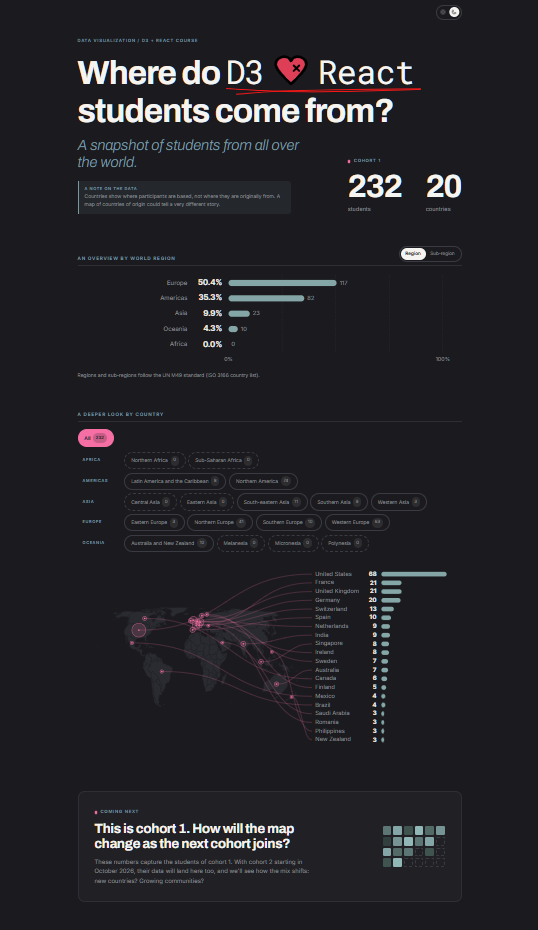

# 🌍 Where do D3 ❤️ React students come from?



An interactive snapshot of where the students of cohort 1 of Yan Holtz's D3 ❤️ React course are based: 232 students from 20 countries, explored by world region and then country by country.

> 🎓 This is a **learning project** I built to practice React and D3 during [Yan Holtz's D3 ❤️ React course](https://www.react-graph-gallery.com/react-d3-dataviz-course).

---

## ✨ What you can do

- **Get the overview.** See each world region's share of students, and switch to the 17 sub-regions.
- **Look closer.** Filter by sub-region or by whole region: the map zooms in, and lines connect each country on the map to its bar.
- **Spot the gaps.** Areas with no students yet (Africa, for now) get their own "waiting for future students" view.
- **Switch theme.** Light and dark mode, remembered for your next visit.

## 🛠️ Tech stack

| Layer     | Tools                                                                  |
| --------- | ---------------------------------------------------------------------- |
| Framework | React + Vite                                                           |
| Charts    | D3 for the maths (scales, Equal Earth projection, curves), React for the rendering |
| Data      | Static JSON files                                                      |

## 📦 Data

- **Students:** counts for cohort 1 by the country where participants are based. A country of origin could tell a very different story.
- **Regions and sub-regions:** the [ISO 3166 country list with regional codes](https://github.com/lukes/ISO-3166-Countries-with-Regional-Codes), which follows the [UN M49 standard](https://unstats.un.org/unsd/methodology/m49/). Countries are matched by their ISO alpha-3 code.
- **Map:** the [world GeoJSON](https://github.com/holtzy/D3-graph-gallery/blob/master/DATA/world.geojson) from the D3 Graph Gallery, drawn with the **Equal Earth** projection, which keeps countries at their true relative size. In September 2026 the UN General Assembly [endorsed Equal Earth](https://news.un.org/en/story/2026/09/1168284) for world maps.

## 🚀 Getting started

```bash
# 1. Clone the repository
git clone https://github.com/manuelam00/first-D3-project.git
cd first-D3-project

# 2. Install dependencies
npm install

# 3. Start the development server
npm run dev
```

## 🗂️ Project structure

```
src/
├── App.jsx               # Page layout, data join and selection state
├── OverviewBarplot.jsx   # Top chart: regions / sub-regions
├── MapBarplot.jsx        # Map + country bars, with the connecting lines
├── ThemeToggle.jsx       # Light / dark switch
├── Footer.jsx            # Data and Methods, credits
├── colors.js             # Chart colours for both themes
├── chart.css             # Styles
├── data.json             # Students per country
├── iso-regions.json      # ISO 3166 countries with UN regions
└── world.json            # World map shapes
docs/                     # Images used in this README
```

## 🙏 Acknowledgements

- **[Yan Holtz's D3 ❤️ React course](https://www.react-graph-gallery.com/react-d3-dataviz-course)**, which this project grew out of
- **Hesham Eissa**, whose Iron Viz 2019 winner [The Global Journey of Refugees](https://public.tableau.com/app/profile/hesham3827/viz/TheGlobalJourneyofRefugees/TheGlobalJourneyofRefugees) inspired the bars feeding lines into the map
